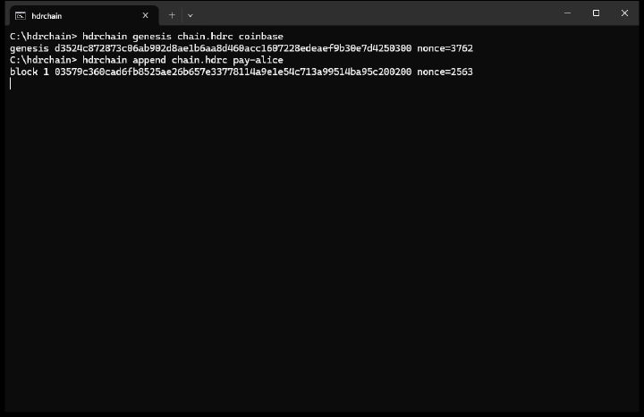

# hdrchain

C++20 SHA-256d header chain. Bitcoin-layout 80-byte headers, Merkle, compact-bits PoW, file `HDRC1`. CLI only — no GUI.



## interface

One prompt, four verbs, one file.

| you type | what the window prints |
|---|---|
| `hdrchain genesis chain.hdrc coinbase` | `genesis <pow-hash> nonce=N` — block 0 mined, file created |
| `hdrchain append chain.hdrc pay-alice` | `block 1 <pow-hash> nonce=N` — prev linked, next mined |
| `hdrchain verify chain.hdrc` | `ok (N blocks)` or `bad prev` / `bad merkle` / `bad pow` |
| `hdrchain show chain.hdrc` | one `#index` line per block, then indented `tx …` |

Prompt in the shot is `C:\hdrchain>`. No menus, no buttons.

### how to read a line

- **hash** — `SHA-256(SHA-256(header))`, 32 bytes, little-endian uint256 ≤ target from `bits`
- **nonce** — the PoW nonce that made that hash pass (`bits = 0x1f0fffff` so a laptop finishes in milliseconds)
- **merkle** — Merkle root of that block’s txs (`sha256d` per leaf; odd level duplicates the last hash)
- **tx** — payload string stored with the block (`coinbase`, `pay-alice`, …)

`verify` re-checks: genesis prev is 32 zero bytes, each next prev equals previous pow-hash, merkle matches txs, PoW holds.

## session

```
C:\hdrchain> hdrchain genesis chain.hdrc coinbase
genesis d3524c872873c96ab902d8ae1b6aa8d468acc1697228edeaef9b30e7d4250380 nonce=3762

C:\hdrchain> hdrchain append chain.hdrc pay-alice
block 1 03579c360cad6fb8525ae26b657e33778114a9e1e54c713a99514ba95c208200 nonce=2563

C:\hdrchain> hdrchain verify chain.hdrc
ok (2 blocks)

C:\hdrchain> hdrchain show chain.hdrc
#0 hash=d352…0380 nonce=3762 bits=1f0fffff txs=1 merkle=…
    tx coinbase
#1 hash=0357…8200 nonce=2563 bits=1f0fffff txs=1 merkle=…
    tx pay-alice
```

Hashes in the still match genesis/append above. `show` / `verify` are in the GIF.

## file

`HDRC1` then one ASCII line per block: 80-byte header hex, then tx hex. Layout is [FORMAT.md](FORMAT.md).

## build

```
cmake -S . -B build -A x64
cmake --build build --config Release
ctest --test-dir build -C Release --output-on-failure
```

```
docker build -t hdrchain .
```

Tests: NIST SHA-256 (empty, `abc`, million `a`), merkle odd/even, broken prev / merkle / nonce, file roundtrip.
